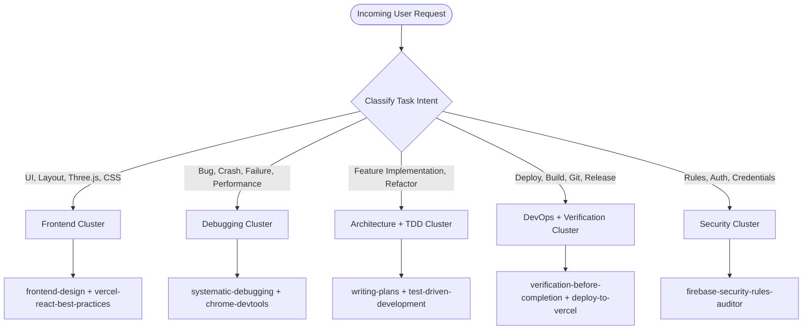

# Antigravity Skill Orchestration System

This document defines the automated skill selection strategy, classification hierarchy, domain gating rules, and conflict resolution protocols for Antigravity in this workspace.

---

## 1. Skill Classification Matrix

Every installed skill is mapped into one of eight functional clusters, with domain-specific skills gated behind explicit project requirements.

| Cluster | Primary Capabilities | Installed Skills |
| :--- | :--- | :--- |
| **Frontend** | UI/UX, styling, design systems, Web components, animations, canvas & 3D WebGL | `frontend-design` (`fskills`), `web-design-guidelines`, `web-artifacts-builder`, `theme-factory`, `generative_ui`, `vercel-react-best-practices`, `vercel-composition-patterns`, `vercel-react-view-transitions`, `canvas-design`, `algorithmic-art`, `redesign-screen`, `plain-writing` |
| **Backend** | Database schemas, serverless logic, authentication, Firestore models | `firebase-firestore`, `firebase-auth-basics`, `firebase-data-connect`, `firebase-app-hosting-basics`, `firebase-hosting-basics`, `firebase-remote-config-basics`, `firebase-analytics`, `extension-to-functions-codebase`, `database-schema-validator`, `json-to-pydantic` |
| **AI & Automation** | Agent orchestration, automated pipelines, prompt engineering | `firebase-ai-logic-basics`, `google-antigravity-sdk`, `brainstorming`, `automation`, `swarm`, `swarm_monitor` |
| **Testing** | TDD, browser automation, visual regression, verification gates | `test-driven-development`, `webapp-testing`, `playwright-cli`, `verification-before-completion` |
| **Debugging** | Root-cause analysis, runtime inspection, memory leaks, performance/CWV | `systematic-debugging`, `chrome-devtools`, `a11y-debugging`, `memory-leak-debugging`, `cookie-debugging`, `debug-optimize-lcp`, `troubleshooting`, `diagnosing-superpowers` |
| **Security** | Access rules, credential management, static review & autofixes | `firebase-security-rules-auditor`, `firestore-rules-creation`, `credentials`, `autofix` |
| **DevOps** | Deployment, CI/CD, branching, git formatting, package management | `deploy-to-vercel`, `vercel-cli-with-tokens`, `vercel-optimize`, `git-commit-formatter`, `finishing-a-development-branch`, `using-git-worktrees`, `license-header-adder`, `uv`, `migrate-agent-settings`, `migrate-workflows` |
| **Architecture** | Planning, execution coordination, code review, documentation | `writing-plans`, `executing-plans`, `dispatching-parallel-agents`, `subagent-driven-development`, `code-review`, `requesting-code-review`, `receiving-code-review`, `writing-skills`, `workflow-skill-creator`, `internal-comms`, `writing-guidelines` |

---

## 2. Task-Based Skill Selection Strategy

When a prompt or task is received, the agent must activate only the skill set relevant to the active context:

### Trigger Rules
1. **Frontend / UI Design Tasks**:
   - Activate `frontend-design` (or `fskills`) and `vercel-react-best-practices`.
   - Never generate cookie-cutter templates. Focus on deliberate color palettes, spatial hierarchy, and responsive containment.
2. **Bug Fixing & Regressions**:
   - Always invoke `systematic-debugging` first. Formulate hypotheses and identify evidence before modifying code.
   - For memory or rendering issues, trigger `memory-leak-debugging` or `chrome-devtools`.
3. **Multi-Step Feature Implementation**:
   - When 3+ files or architectural changes are planned, trigger `writing-plans` to generate an implementation plan with user check-ins.
   - Execute using `executing-plans` (inline) or `subagent-driven-development` (if subagent tools are enabled).
4. **Pre-Completion & Merging**:
   - Always run `verification-before-completion`. Execute `npm run build` or automated test suites and verify exit code 0 before asserting completion.
   - Format commits using `git-commit-formatter`.
5. **Deployment**:
   - Use `deploy-to-vercel` or `vercel-cli-with-tokens`. Run `vercel-optimize` to audit bundle size and performance.

---

## 3. Domain Gating (Preventing Unrelated Skill Activation)

To protect the context window from pollution and prevent model confusion:

- **Gated Domain: Bioinformatics & Life Sciences**
  - Skills: `alphafold-*`, `alphagenome-*`, `biomolecular-structure-viewer`, `chembl-database`, `cheminformatics-*`, `clinical-trials-database`, `clinvar-database`, `dbsnp-database`, `embl-ebi-ols`, `encode-ccres-database`, `ensembl-database`, `foldseek-structural-search`, `gnomad-database`, `gtex-database`, `human-protein-atlas-database`, `interpro-database`, `jaspar-database`, `literature-search-*`, `ncbi-sequence-fetch`, `openfda-database`, `opentargets-database`, `pdb-database`, `predictingthepast`, `protein-sequence-*`, `pubchem-database`, `pubmed-database`, `pymol`, `quickgo-database`, `rdkit-general`, `reactome-database`, `string-database`, `ucsc-conservation-and-tfbs`, `unibind-database`, `uniprot-database`.
  - **Rule**: STRICTLY INACTIVE unless the user explicitly requests biological, chemical, or clinical protein analysis.
- **Gated Domain: Native Mobile Platforms**
  - Skills: `android-cli`, `android-device-hub`, `compose-preview`, `xcode-project-setup`, `vercel-react-native-skills`.
  - **Rule**: STRICTLY INACTIVE in web, Next.js, and Three.js repositories unless Android/iOS native bindings are explicitly targeted.
- **Gated Domain: Document Creation**
  - Skills: `docx`, `pptx`, `pdf`, `xlsx`, `canva-*`, `slack-gif-creator`.
  - **Rule**: ACTIVE ONLY when generating document files or presentation decks; never during code refactoring.

---

## 4. Conflict Detection & Resolution Protocols

When two or more skills contain overlapping or conflicting guidance, resolve using these precedence rules:

1. **Inline Execution vs Subagent Delegation**:
   - `subagent-driven-development` takes precedence when modular, parallel subtasks exist and `invoke_subagent` is available.
   - `executing-plans` takes precedence if subagents are disabled or when modifying tightly coupled state.
2. **Review Feedback vs Implementation Speed**:
   - `receiving-code-review` and `autofix` require evidence and technical verification before blind implementation. If review feedback contradicts project requirements, prioritize project requirements and document the rationale.
3. **Design Guidelines Precedence**:
   - User-defined project rules (in `.agents/rules/*.md`) override generic skill instructions.
   - `frontend-design` takes precedence over generic layout suggestions.
4. **Git Branching Rule**:
   - Workspace rule: All work in this repository must be committed and pushed to the designated feature branch (`robin`), NEVER directly to `main`.
